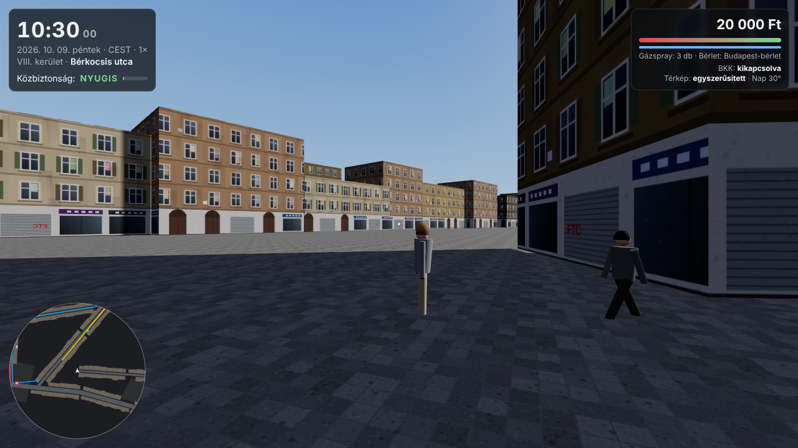

# Budapest Online – Józsefváros (HTML játék)

Böngészős 3D játék Budapest **VIII. kerületében**. Valódi térkép, valódi idő, valódi BKK-járatok.



**Mi van benne:**
- **Valódi térkép:** a játék az OpenStreetMapről tölti le a kerület épületeit (magasság, udvarok), utcáit, villamossíneit, fáit, lámpáit, üzleteit és tereit. Ha a letöltés nem sikerül, egy egyszerűsített, beépített térképpel indul.
- **Valódi 24 órás nap:** a játékidő a budapesti órához igazodik (nyári és téli időszámítással). A nap és a hold a valódi helyén áll, van szürkület és holdfázis. Este kigyulladnak az ablakok és az utcai lámpák.
- **Működő BKK:** a **99-es busz**, a **23-as, 24-es és 28A villamos** a BKK élő járműadatai alapján mozog (a beállított BudapestGO kulccsal). Ahol nincs élő adat, ott a BKK menetrendje szerint közlekednek. Megállókban **E-vel felszállsz**, utazol, és leszállsz.
- **M2 metró a Blahától a Keletiig:** lemész a lejárón, megvárod a szerelvényt a peronon, beszállsz, végigmész az alagúton, és a Keletinél jössz fel. A metró menetrend szerint jár.
- **Sok járókelő:** csúcsidőben több ezer ember van az utcán, éjjel jóval kevesebb. Vegyes, valósághű lakosság, sokféle bőrtónussal.
- **Közbiztonság napszak szerint:** reggel és napközben *nyugis*, este *feszült*, éjjel *gatya*. A sötét mellékutcák veszélyesebbek, mint a kivilágított főutak. Leszólíthatnak, kérhetnek pénzt, ki is rabolhatnak. A bajt mindig véletlenszerűen kiválasztott járókelő okozza: a kinézet semmilyen szerepet nem játszik benne (ezt teszt is ellenőrzi). Önvédelemnek van gázspray, ütés és futás.
- **Vape árusok:** az OSM-ben szereplő valódi vape boltok előtt eladók állnak, és a forgalmas helyeken (megállók, metrólejárók) utcai standok vannak. E-vel vásárolhatsz.

## Indítás

A játékhoz nem kell telepíteni semmit, de **webszerverről** kell futnia, nem `file://`-ból:
- **GitHub Pages (ajánlott):** a repó *Settings → Pages* menüjében válaszd ki forrásnak a `main` ágat és a `/ (root)` mappát. Pár perc múlva a játék elérhető a `https://szamocaa.github.io/BudapestOnline/` címen.
- **Saját gépen:** a repó mappájában futtasd a `python3 -m http.server 8000` parancsot, majd nyisd meg a `http://localhost:8000` címet.

Az első indításkor a térkép letöltése az OpenStreetMapről 20–90 másodperc, utána a böngésző eltárolja. Ha azonnali betöltést szeretnél, egyszer futtasd le ezt, és töltsd fel a létrejött `data/district8.json` fájlt:
```
node tools/bake_snapshot.mjs
```

### Irányítás
| Gomb | Mit csinál |
|---|---|
| W A S D + egér | séta, körülnézés (kattints a képre az egérhez) |
| Shift | futás |
| E | fel- és leszállás, metrólejáró, vásárlás |
| 1–4 | válasz, ha leszólítanak |
| M | térkép nagyítása |
| [ ] | idő lassítása és gyorsítása (alapból valós idő) |
| H | súgó |

Mobilon bal oldalt egy virtuális joystick van, jobb oldalt húzással nézel körbe, a sárga gomb pedig az E.

### Beállítások a címsorban
`index.html?time=2026-10-09T22:30` (adott időpont), `&speed=60` (gyorsított idő), `&people=1500` (kevesebb ember gyengébb gépen), `&quality=low`, `&fallback=1` (beépített térkép), `&nolive=1` (élő BKK adat nélkül).

## BKK API kulcs
A kulcs a `game/config.js` fájlban van (`bkkKey`). Mivel böngészős játék, a kulcsot bárki látja, aki megnyitja az oldalt, ahogy minden webes BKK-alkalmazásnál. Ha gond van vele, az opendata.bkk.hu oldalon újat kérhetsz, és kicserélheted. A játék a `futar.bkk.hu` FUTÁR API-t hívja (`vehicles-for-route`, `route-details`). Más GitHub Pages oldalak is így használják. Ha a böngésző mégis letiltaná, a játék menetrend szerint működik tovább, és a jobb felső sarokban kiírja az okát.

## Mi pontos és mi nem
| Rész | Állapot |
|---|---|
| Nap- és holdállás, budapesti idő | ellenőrizve (PyEphem és tz-adatbázis, a nap 0,01°-on belül) |
| BKK válaszok feldolgozása, kódolt vonalak | tesztelve a valódi API-válaszok formájával |
| Járatok útvonala és megállói (99, 23, 24, 28A, M2) | a BKK GTFS adataiból (2026. június); élő módban a BKK `route-details` adja |
| Menetrend (követési idők, első és utolsó járat) | a BKK GTFS alapján, kerekítve; az őszi menetrend kicsit eltérhet |
| Élő BKK kapcsolat és OpenStreetMap letöltés | itt nem tudtam kipróbálni (hálózati korlát), de más oldalakon ugyanígy működik |
| Beépített (offline) térkép | közelítés: a fő utcák és megállók jók, a házak kitaláltak |
| Az M2 élő pozíciói | a BKK valószínűleg nem ad metró-GPS-t, ezért menetrend szerint jár |

Tesztek: `tests/web/run.sh` (Node 18+), böngészős próba: `npm i playwright && node tests/web/play.mjs`.

## Adatok és licencek
- Térkép: © OpenStreetMap közreműködők, ODbL.
- Járatadatok: BKK Zrt., CC BY 4.0.
- 3D motor: three.js (MIT), a `game/vendor` mappában.

---

# Unreal Engine verzió (korábbi)

# Budapest Sim

A real-time Budapest simulator for Unreal Engine 5, starting with **VIII. district (Józsefváros)**:

- the district's buildings, extruded from OpenStreetMap footprints (courtyards included)
- live trams, metro and buses from BKK's open data (simulated vehicles until you add an API key)
- pedestrians who walk the real street network, in numbers that follow the time of day
- a real 24-hour sky: sun, moon and twilight at Budapest's true position, in Budapest local time (daylight saving included)

The project is C++ only (no binary assets), so everything here is plain text.

## Status: what is verified and what is not

| Part | Status |
|---|---|
| GTFS-realtime decoder (`Transit/GtfsRtDecoder`) | **Tested** against the official protobuf library's output, with sanitizers and 20k corruption fuzz runs |
| Sun, moon, Budapest clock (`World/Astro`) | **Tested** against PyEphem and Python's tz database: sun within 0.011°, moon within 0.3° elevation, every DST switch second correct |
| Baked-data reader and building mesher (`City/*`) | **Tested**: closed solids, outward-facing triangles in every ring orientation (breaking the winding on purpose makes the tests fail) |
| OSM baker (`Tools/Districts/bake_district.py`) | **Tested on hand-made data in Overpass's format.** Not yet run against the live OpenStreetMap servers: they were unreachable from where this was written |
| All Unreal C++ (actors, subsystem, settings, game mode) | **Written but never compiled.** It needs a first build in your editor; expect a few small compile errors to fix |
| BKK feed URL and key placement | **Unverified.** The default URL is from memory; check it with `Tools/check_bkk_feed.sh` and BKK's docs |

Run everything that does not need the engine with `Tools/run_tests.sh`.

## Quick start

1. **Engine:** Unreal Engine 5.3 or newer (written for 5.8). The `.uproject` says 5.8; if you have another version, right-click `BudapestSim.uproject` → *Switch Unreal Engine version*.
2. **Build the district data** (needs internet, once):
   ```bash
   pip install -r Tools/Districts/requirements.txt
   python3 Tools/Districts/bake_district.py all
   ```
   This writes `Content/Data/district8_buildings.bsb` and `district8_paths.bsb`. Without them the game still runs, but with an empty city and no pedestrians.
3. **Generate project files and build:** right-click `BudapestSim.uproject` → *Generate project files*, open the solution/workspace, build `BudapestSimEditor`, then open the project. (Or double-click the `.uproject` and let the editor compile.)
4. **Play:** open any level (an empty one is fine) and press Play. The game mode builds the whole simulation by itself.

### Controls

| Key | Action |
|---|---|
| W A S D + mouse | fly |
| Q / E | down / up |
| G | toggle street level (eye height) and bird's-eye view |
| `,` / `.` | slower / faster clock (×1, ×10, ×60, ×600, ×3600) |
| T | back to real time |

Console: `SetTimeOfDay 22.5` jumps to 22:30, `SetTimeScale 60` runs one game minute per real second.

## Live transit data (BKK)

1. Register at <https://opendata.bkk.hu> and request an API key.
2. Provide it either way:
   - environment variable `BKK_API_KEY` (a Mac editor started from Finder will not see shell variables), or
   - *Project Settings → Game → Budapest Transit → Api Key* (saved under `Saved/Config`, which git ignores, so the key never lands in the repo).
3. Check it works before launching the editor: `BKK_API_KEY=... Tools/check_bkk_feed.sh`. It downloads one snapshot, decodes it with the game's decoder and lists some vehicles.

If BKK's documentation shows a different URL, or wants the key in a header, change *Vehicle Positions Url Template* (use `{key}` where the key goes) and *Api Key Header Name*.

Until a key is set, a simulated feed of 36 vehicles circles the district so you can see the pipeline working. The on-screen status line says `SIMULATED` or `LIVE`.

Vehicles outside the VIII. district are skipped (toggle `bRestrictToDistrictVIII` on the Transit Manager). Their type is not known yet, so live vehicles are coloured per route; see the roadmap.

## Buildings: why OpenStreetMap and not Google Maps

Recreating buildings by extracting geometry from Google Maps is not allowed by Google's terms, and there is no API that returns building geometry. OpenStreetMap's open data has footprints, heights and levels for most of the district, is free to use with attribution, and lets us build real 3D geometry. If you later want Google's photorealistic look, the permitted route is to *stream* their 3D tiles with the Cesium for Unreal plugin, which you can add alongside this.

What the baker does with the district:

- downloads every `building=*` way and multipolygon in the district boundary (courtyards become holes)
- uses `height`, else `building:levels × 3.2 m`, else a typical height for the building type, else 16 m (so many buildings are estimated: Józsefváros is mostly 4–6 storeys)
- triangulates roofs, builds a walkable street graph from `highway=*` ways
- limitations of this first version: flat roofs only (no gables or domes), `building:part` outlines are ignored

## Realistic pedestrians

Out of the box pedestrians are simple placeholder figures, because realistic people are art assets that have to be imported in the editor. To get lifelike ones:

1. Get human characters: [MetaHuman](https://www.unrealengine.com/metahuman) (free with Unreal, build them in MetaHuman Creator and export them to the project), or Fab / Mixamo characters.
2. In the editor, create a Blueprint whose parent class is **NpcCharacter**. Set its *Mesh* to the character's skeletal mesh and its *Anim Class* to an animation Blueprint made for that character's skeleton (MetaHumans and Epic's mannequins come with one; other characters need theirs retargeted). The animation Blueprint should drive walking from the character's velocity, which is how the Third Person template's does it.
3. If your character walks sideways, change *Mesh Yaw Offset* on the Blueprint (default −90, right for Epic's mannequin).
4. Make several (different people, ages, clothes) and add them under *Project Settings → Game → Budapest World → Pedestrian Classes*.

The system handles the rest: where they walk, how many are out, spawning near the camera only.

MetaHuman note: a MetaHuman is a body plus a separate face mesh and hair. Start by using the body mesh alone, which already looks like a person from street distance; the head and hair take extra setup in the Blueprint.

## The day cycle

`ADayCycleActor` computes the sun and moon's real position for Budapest at the simulated time, and drives a directional light for each, plus sky atmosphere, a real-time-captured sky light, fog and exposure. At speed ×1 the game clock *is* Budapest's clock; use `,` `.` to speed it up.

Not done yet: stars, clouds and weather, lit windows and street lights at night. Night brightness and the sun/moon intensities (`SunIntensity`, `MoonMaxIntensity` on the actor) will need tuning by eye in the editor.

Pedestrian numbers follow an hour-by-hour curve (`ANpcManager::DensityForHour`): near empty at 3 am, peaks around 8 and 17, a lunch bump. It is a plausible rhythm, not measured data.

## Project layout

```
Source/BudapestSim/
  Transit/   BKK feed (HTTP polling, protobuf decoder), vehicles, mock feed, lat/lon projection
  City/      baked-data reader, building mesher, district actor, pedestrian street graph
  Npc/       pedestrian character and crowd manager
  World/     astronomy, day-cycle actor, settings
  Game/      game mode (builds everything) and the flying pawn
Tools/
  Districts/ OSM download + bake (Python) and its tests/fixtures
  DecoderTest, CoreTests/   engine-free tests;  run_tests.sh runs them all
  check_bkk_feed.sh         test your BKK key and URL outside Unreal
```

World coordinates: +X = north, +Y = east, +Z = up, in centimetres, origin at the district centre. Compass bearings therefore equal actor yaw.

## Roadmap

1. Compile and fix first-build errors; run the baker on real data and look at the district.
2. Static GTFS import (`routes.txt` route types) so vehicles are correctly trams, metro or buses, with line colours and proper models. Metro belongs underground.
3. Real vehicle and building models and materials instead of boxes (windows, balconies, roof shapes).
4. Street furniture, lit windows and street lights at night, stars, weather.
5. A walking first-person mode, then driving/riding trams.
6. Grow beyond the VIII. district.

## Data and licences

- Buildings and streets: © [OpenStreetMap](https://www.openstreetmap.org/copyright) contributors, ODbL. Keep this attribution in anything you show or publish. If you publish the baked `.bsb` files, publish them under the ODbL too.
- Transit data: BKK open data. Follow the terms you accept when you request your key.
